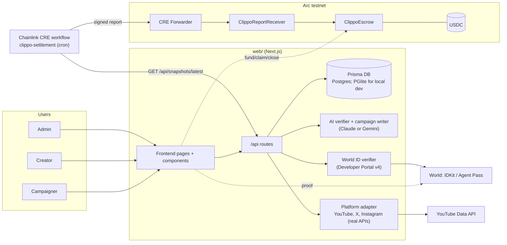
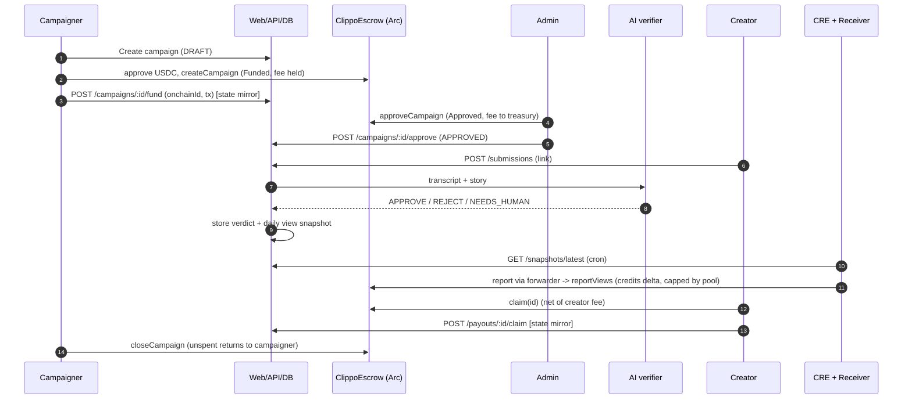

# Architecture

## System

Dotted links are client-side calls (browser wallet and IDKit). The web-to-escrow calls are real viem transactions when `ESCROW_ADDRESS` is set; without it chain routes answer 503 `NOT_CONFIGURED`. Nothing here has been run against a live Arc deployment from this repo (see the README status table).

## Money flow

What is real in this flow:

- Every step on `ClippoEscrow` is implemented and tested in `contracts/`. From the web app they are sent with real viem calls (`web/src/lib/chain/client.ts`) when `ESCROW_ADDRESS` is set, otherwise the chain routes answer 503 `NOT_CONFIGURED` (no fake tx hashes outside the explicit `NEXT_PUBLIC_DEMO=1` demo mode). The API verifies and indexes the receipts (`web/src/lib/chain`).
- HumanSplit: `POST /api/campaigns/:id/split` requires a fresh World ID proof (the Agent Pass step) and creates PENDING payouts in the DB. The backend does not call on-chain `approveSplit`.
- Reject path: `rejectCampaign` on-chain refunds the full pool including the held fee.
- Snapshot feed: `/api/snapshots/latest` emits the numeric on-chain escrow id as `campaignId` (`web/src/lib/snapshots.ts`); campaigns without an `onchainId` are skipped, so the CRE `snapshot.ts` uint256 check is satisfied (covered by a shared fixture test). A live CRE broadcast has not been run.

## Components to files

| Component | Files |
| --- | --- |
| Frontend | `web/src/app/(site)/*`, `web/src/components/*`, data seam `components/api.ts` |
| API | `web/src/app/api/**/route.ts`, `web/src/lib/{auth,http,domain,earnings,snapshots}.ts` |
| DB | `web/prisma/schema.prisma` (Postgres datasource; models include User, Channel, Campaign, Submission, Verdict, ViewSnapshot, Payout and more) |
| AI verifier | `web/src/lib/ai/{verifier,llm,duplicates,campaign-writer}.ts` (provider switch `LLM_PROVIDER`: Anthropic or Gemini) |
| World ID | `web/src/lib/worldid/index.ts`, `web/src/app/api/worldid/verify/route.ts`, `components/WorldCheck.tsx` |
| Platforms | `web/src/lib/youtube/index.ts` |
| Escrow | `contracts/src/ClippoEscrow.sol`, `ClippoReportReceiver.sol`, `MockUSDC.sol`, `script/Deploy.s.sol` |
| CRE | `cre/workflows/clippo-settlement/{main,snapshot}.ts` |
